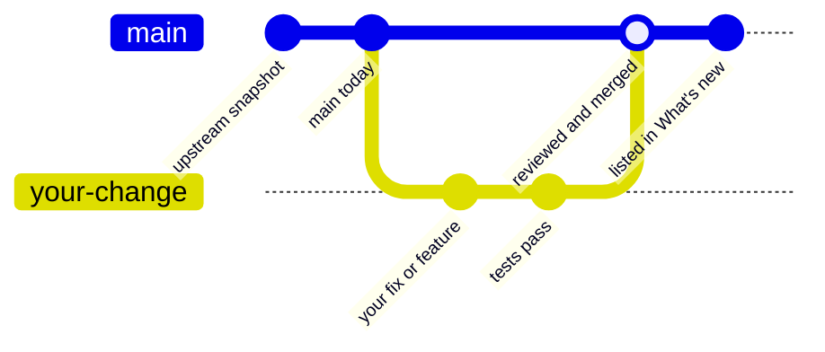

<picture>
  <source media="(prefers-color-scheme: dark)" srcset="docs/assets/hero-dark.svg">
  
</picture>

 

**[Getting started](#getting-started)** · **[Help wanted](#help-wanted)** · **[What's new](#whats-new)** · **[Deploy with an agent](AGENTS_DEPLOY.md)**

## What it is

CloudCLI-MobileUI is a web interface for [Claude Code](https://docs.anthropic.com/en/docs/claude-code) that you host yourself. Claude Code keeps running on your workstation, with your files, your tools and your login, and you open the interface from any phone, tablet or laptop on your network. On an iPhone or Android phone you can add it to the home screen, and it behaves like an app.

You get the whole Claude Code session in your hand: the conversation, the files it is working on, git, and a terminal. You can read what the agent did while you were away, answer its questions, approve a tool, or start the next task.

> **Setting this up with an AI agent?** Point it at [AGENTS_DEPLOY.md](AGENTS_DEPLOY.md). It has the exact steps, checks and settings, written for agents.

## How it works

<picture>
  <source media="(prefers-color-scheme: dark)" srcset="docs/assets/how-it-works-dark.svg">
  
</picture>

The interface is a small Node.js server that runs on your workstation, right next to Claude Code. Your phone only talks to that server, over your home network or a VPN. Claude Code, your files and your login stay on the workstation, and conversations you started in the terminal show up in the interface too.

## Why we built it

Long agent runs, such as a literature search, a test suite or a data-processing job, happen on a workstation, but the questions and decisions tend to come up when you are away from the desk. We wanted to keep working with the very same session from a phone, instead of waiting until we were back at the keyboard.

[CloudCLI](https://github.com/siteboon/claudecodeui) already provided a solid open-source web interface for Claude Code, and this project is built on its code. What we kept running into was the phone side of things: moving around on a small touch screen, scrolling long conversations, the iPhone home-screen app, very large projects, files that live outside the home folder, and background agents being stopped when we sent a new message. This project collects the changes that fix those.

It is an independent project and is not affiliated with the CloudCLI authors. If something goes wrong, please [open an issue here](https://github.com/Aztech-Lab/CloudCLI-MobileUI/issues) rather than upstream.

## What is different from CloudCLI

<table>
<tr>
<td width="50%" valign="top">

**Easier on a phone**

Swipe left and right anywhere on the screen to move between the chat, files, git and the terminal; swipe right from the chat to open the menu. Long conversations scroll smoothly, the iPhone home-screen app fills the whole screen, and your most recent conversations are one tap away when you open it.

</td>
<td width="50%" valign="top">

**Built for longer work**

The model picker lists exactly the models your Claude Code account offers. Projects with tens of thousands of files still show their file tree, and folders load when you open them. Files the agent mentions can be opened even when they live on another drive, as long as you allow that folder.

</td>
</tr>
<tr>
<td width="50%" valign="top">

**Your own look**

A skin setting changes how the whole interface looks. The first skin, OTSR, takes its look from the [OTSR design](https://github.com/Aztech-Lab/OTSR): a quiet lab-white (or near-black) design with a copper accent and square edges, and you can tune its details, such as the dotted background, to taste.

</td>
<td width="50%" valign="top">

**Keep talking while work runs**

Background agents and long commands keep running while you go on talking to the main conversation, and report back when they are done, the way the official Claude Code app behaves. Stop ends only the current reply; a separate button stops all background work ([#1](https://github.com/Aztech-Lab/CloudCLI-MobileUI/pull/1)). Next: messages that reach the agent mid-step, and moving a running step to the background.

</td>
</tr>
</table>

<picture>
  <source media="(prefers-color-scheme: dark)" srcset="docs/assets/skins-dark.svg">
  
</picture>

The pictures in this README use the OTSR colors and shapes. OTSR design: <a href="https://github.com/Aztech-Lab/OTSR">github.com/Aztech-Lab/OTSR</a>.

## Getting started

You need a computer that stays on, with [Node.js](https://nodejs.org) 22 or newer and Claude Code installed and logged in. Then download this project, build it and start it. The commands are in [AGENTS_DEPLOY.md](AGENTS_DEPLOY.md) and take a few minutes; you can also hand that file to an AI agent and let it do the setup for you.

When it is running, open `http://<your-computer's-address>:3001` in a browser. The first person to open it creates the one and only account, so do that yourself straight away. On an iPhone, open the page in Safari, tap **Share**, then **Add to Home Screen**.

## Please keep it private

Whoever logs in can do anything on that computer that you can. Use the interface only on your own network or through a VPN, never expose it directly to the internet, choose a strong password, and in the tool settings allow only the tools you actually need. [AGENTS_DEPLOY.md](AGENTS_DEPLOY.md#security) shows how to limit the port to your own network.

## Help wanted

This is a young, small project, and there is room to help whether or not you write code. Here is where things stand:

<table>
<tr>
<th width="33%" align="left">Now</th>
<th width="33%" align="left">Next</th>
<th width="34%" align="left">Ideas</th>
</tr>
<tr>
<td valign="top">

Matching the official Claude Code app while work runs in the background: a message you send mid-step should reach the agent at the next pause instead of waiting for the step to end, and a running step should be movable to the background.

</td>
<td valign="top">

A few links inside the app (the About page, the star badge, the issue and community links) still point to the original CloudCLI project. They should point here, so that nobody sends our problems to its authors.

</td>
<td valign="top">

More skins · code colors that follow the skin · a tablet layout · translations · testing on Android

</td>
</tr>
</table>

Good places to start:

- **Design a skin.** A skin is mostly a set of CSS variables, plus a few optional signature rules and settings, so you can change the whole look without touching any component. [docs/fork/THEMING.md](docs/fork/THEMING.md) has a step-by-step checklist. The designs themselves live in [`themes/`](themes/) as packages that any project can apply.
- **Make code colors follow the skin.** Syntax highlighting in the chat, the code editor and the git graph still use fixed colors; THEMING.md lists where they live.
- **Translate.** Several languages are missing strings, including some that this project added for the home screen and the file tree. They live in `src/modules/i18n/locales`, with English as the reference.
- **Try it on your phone and tell us what breaks.** Reports from Android phones and tablets are especially welcome, because most testing so far has been on iPhones.

### How a change gets in

Make one branch per change, starting from `main`, and open a pull request in this repository. The template asks what changed, why, and how you tested it. A maintainer reviews and merges it and writes it up under "What's new". [CONTRIBUTING.md](CONTRIBUTING.md) has the details, including how to set up a development copy.

## What's new

**16 November 2026**
- You can keep talking to the main conversation while background agents and long commands run: a new message no longer stops them, Stop ends only the current reply, a "Stop all background work" button ends the rest, and quiet long-running tasks are no longer cut off after 30 minutes ([#1](https://github.com/Aztech-Lab/CloudCLI-MobileUI/pull/1)).
- Updated to CloudCLI 1.37.9: the Claude model picker also offers pinned model versions, and pressing Escape in a rename box or menu no longer stops the running reply.
- The agent's replies now sit in a bubble of their own, like your messages, so a conversation reads as a back-and-forth ([#8](https://github.com/Aztech-Lab/CloudCLI-MobileUI/pull/8)). Under Settings › Appearance you can choose a solid bubble, a translucent one, or none ([#9](https://github.com/Aztech-Lab/CloudCLI-MobileUI/pull/9)).
- Codex chats have a new mode, "Approve for me": Codex's own reviewer decides on routine approvals, as in the Codex app. And when a conversation is still open in the Codex app, which lets only one program write to it at a time, CloudCLI now says so instead of showing a generic failure ([#11](https://github.com/Aztech-Lab/CloudCLI-MobileUI/pull/11)).

**15 November 2026**
- Codex chats use Codex 0.169, so newer models such as gpt-6.1-sol work from CloudCLI. This is ahead of the version upstream CloudCLI pins ([#7](https://github.com/Aztech-Lab/CloudCLI-MobileUI/pull/7)).
- A Codex conversation that you edited in CloudCLI and then continued in the Codex app no longer disappears from the sidebar ([#6](https://github.com/Aztech-Lab/CloudCLI-MobileUI/pull/6)).
- On Windows, a folder that was opened both as `E:\…` and `e:\…` now shows up as one project with all its sessions, instead of two. Nothing is rewritten: each session keeps running in the folder it was recorded with ([#5](https://github.com/Aztech-Lab/CloudCLI-MobileUI/pull/5)).
- The header stays on one line at every width: wide screens show the full conversation title instead of cutting it short, and phones no longer stack the title above the tabs.
- The OTSR skin now uses the exact colors of the original design: the real copper and secondary text, black labels on copper and green buttons in dark mode, and a soft shadow under floating panels ([#4](https://github.com/Aztech-Lab/CloudCLI-MobileUI/pull/4)).
- The OTSR design is now also a reusable package in [`themes/otsr`](themes/otsr/), and the theming guide describes the skin system as it really works ([#2](https://github.com/Aztech-Lab/CloudCLI-MobileUI/pull/2), [#3](https://github.com/Aztech-Lab/CloudCLI-MobileUI/pull/3)).
- Skins now have their own settings. For OTSR you can choose how strong the dotted background is, and switch the cut corners, monospaced labels and square status dots on or off. The dotted background is softer by default.

**14 November 2026**
- New skin setting, with the OTSR skin in light and dark.
- Behind the scenes, the interface was prepared for skins; nothing changed visually.
- The home screen shows your recent conversations and projects.
- Swipe between tabs anywhere on the screen; the terminal tab moved to the end.
- Long conversations no longer stutter when you scroll up on a phone.
- The iPhone home-screen app no longer leaves an empty strip at the bottom.
- The model picker shows the models your account actually has.
- Large projects and files outside the home folder can be browsed and opened.
- First release, based on CloudCLI 1.37.8.

## License and credits

CloudCLI-MobileUI is free software under the [GNU AGPL v3](LICENSE) or later. If you run a modified version for other people, the license asks you to share its source with them.

It is based on CloudCLI by Siteboon AI B.V. and its contributors (see [NOTICE](NOTICE)). Guides for contributors and maintainers: [CONTRIBUTING.md](CONTRIBUTING.md), [docs/fork/SESSION-GUIDE.md](docs/fork/SESSION-GUIDE.md) and [docs/fork/MAINTAINING.md](docs/fork/MAINTAINING.md).

## Acknowledgements
The changes in this repository and their ongoing maintenance are by [Aztech Labs](https://github.com/Aztech-Lab). 
